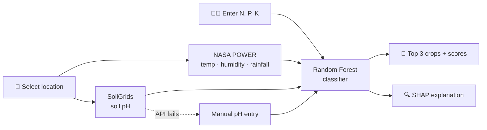

<div align="center">

# 🌱 Location-Aware Crop Recommendation System

**Pick a spot on the map, add your soil nutrients, and get the top 3 crops, with an explanation of *why*.**

*"Location-aware" = the app pulls climate and soil data for your chosen coordinates. The model itself is trained on non-geographic data.*

[](https://crop-recommendation-mahek.streamlit.app/)
[](https://www.python.org/)
[](https://scikit-learn.org/)
[](https://shap.readthedocs.io/)
[](#-limitations)

[🚀 **Live Demo**](https://crop-recommendation-mahek.streamlit.app/) · [💻 **Source**](https://github.com/mahekkamdar02-lab/crop-recommendation-system) · [🐞 **Report an Issue**](https://github.com/mahekkamdar02-lab/crop-recommendation-system/issues)

<!-- Add a screenshot or GIF of the app here:
 -->

</div>

---

## 📑 Table of Contents

- [Overview](#-overview)
- [Features](#-features)
- [How It Works](#-how-it-works)
- [Quick Start](#-quick-start)
- [Dataset](#-dataset)
- [Model Training & Validation](#-model-training--validation)
- [Explainability with SHAP](#-explainability-with-shap)
- [Tech Stack](#-tech-stack)
- [Project Structure](#-project-structure)
- [Limitations](#-limitations)
- [Roadmap](#-roadmap)

---

## 📌 Overview

Choosing the right crop depends on many interacting factors: soil nutrients (N, P, K), pH, temperature, humidity and rainfall. This project simplifies that decision by combining a machine learning model with **location-based environmental data**.

1. Pick a location on an interactive map (or enter coordinates).
2. The app fetches climate and soil pH data automatically.
3. You enter Nitrogen, Phosphorus and Potassium values.
4. A Random Forest model returns the **top 3 crop recommendations**.
5. **SHAP** shows which inputs pushed each recommendation up or down.

### What "location-aware" means here

| ✅ What the app does | ❌ What it does not do |
|---|---|
| Uses your chosen coordinates to **retrieve** local climate (NASA POWER) and soil pH (SoilGrids) | Learn region-specific crop patterns |
| Feeds those retrieved values into the model as inputs | Use latitude/longitude as model features |
| Lets you compare recommendations across different locations | Claim to generalize to unseen regions (not yet validated) |

In short, location determines the **inputs**; the classifier itself is location-agnostic. See [Limitations](#-limitations) and the [Roadmap](#-roadmap) for how this could be extended.

---

## ✨ Features

| | Feature | Details |
|---|---|---|
| 🗺️ | **Interactive location picker** | Click on a map or type latitude/longitude |
| 🌦️ | **Automatic climate data** | Temperature, humidity and rainfall from [NASA POWER](https://power.larc.nasa.gov/) |
| 🧪 | **Soil pH lookup** | From [ISRIC SoilGrids](https://soilgrids.org/), with manual entry as a fallback |
| 🌾 | **Nutrient inputs** | Enter N, P and K values directly |
| 🤖 | **Top-3 predictions** | Random Forest class scores for each recommended crop |
| 🔍 | **Explainable AI** | Per-prediction SHAP feature-contribution plots |
| 🛟 | **Graceful fallbacks** | App stays usable when external APIs are down |

---

## ⚙️ How It Works



---

## 🚀 Quick Start

**Prerequisites:** Python 3.9+ and `git`.

```bash
# 1. Clone and enter the project
git clone https://github.com/mahekkamdar02-lab/crop-recommendation-system.git
cd crop-recommendation-system

# 2. Create and activate a virtual environment
python -m venv venv
source venv/bin/activate          # macOS / Linux
# .\venv\Scripts\Activate.ps1     # Windows PowerShell

# 3. Install dependencies
pip install -r requirements.txt

# 4. Launch the app
python -m streamlit run app.py
```

Then open **http://localhost:8501** in your browser.

---

## 📊 Dataset

Trained on the [Kaggle Crop Recommendation Dataset](https://www.kaggle.com/datasets/atharvaingle/crop-recommendation-dataset): **2,200 records** across **22 crop classes**.

| Feature | Description |
|---|---|
| `N`, `P`, `K` | Soil nitrogen, phosphorus and potassium content |
| `temperature` | Temperature (°C) |
| `humidity` | Relative humidity (%) |
| `ph` | Soil pH |
| `rainfall` | Rainfall (mm) |
| `label` | Target crop (22 classes) |

> ⚠️ The dataset has **no geographic coordinates or region identifiers**, so the model cannot learn location-specific crop patterns.

---

## 🤖 Model Training & Validation

Retrain the model from the original dataset:

```bash
python train.py --data data/Crop_recommendation.csv
```

The training script supports:

- ✅ Random Forest classification
- ✅ Optional XGBoost comparison (when installed)
- ✅ 5-fold cross-validation
- ✅ Accuracy, precision, recall and F1-score reporting
- ✅ Leave-region-out validation via `--group-col` (requires a region-labelled dataset)
- ✅ Model serialization with Joblib → `models/crop_model.joblib`

### Validation caveat

Because the Kaggle data has no region labels, cross-validation here measures performance on **randomly split samples, not unseen geographic regions**. Regional generalization has **not** been established.

---

## 🧠 Explainability with SHAP

For each recommendation, the app plots how every input feature contributed to the prediction:

| SHAP value | Meaning |
|---|---|
| **Positive** | Pushes the model toward the explained crop |
| **Negative** | Pushes the model away from the explained crop |
| **Larger magnitude** | Stronger influence (on the model-output scale) |

This makes it easy to see, for example, whether rainfall or potassium was the deciding factor behind a recommendation.

---

## 🛠️ Tech Stack

| Category | Tools |
|---|---|
| Language | Python |
| ML | scikit-learn (Random Forest) |
| Explainability | SHAP |
| Data | Pandas, NumPy |
| Visualization | Matplotlib |
| Web app | Streamlit |
| Maps | Folium, streamlit-folium |
| Data sources | NASA POWER, ISRIC SoilGrids |
| Serialization | Joblib |
| Deployment | Streamlit Community Cloud |

---

## 📁 Project Structure

```text
crop-recommendation-system/
├── app.py               # Streamlit application
├── train.py             # Model training and evaluation
├── model_utils.py       # Model loading, prediction and SHAP utilities
├── location.py          # NASA POWER / SoilGrids data retrieval
├── audit_data.py        # Dataset auditing
├── make_synthetic.py    # Synthetic demo data generator
├── data/
│   ├── Crop_recommendation.csv
│   └── synthetic_demo.csv
├── models/
│   └── crop_model.joblib
├── requirements.txt
└── README.md
```

---

## ⚠️ Limitations

This is an **academic prototype and decision-support demo**, not a substitute for professional agricultural advice.

1. **No geographic learning.** The classifier was never trained on coordinates or regions.
2. **External API dependence.** NASA POWER and SoilGrids may be slow or unavailable (SoilGrids sometimes returns HTTP 503). Manual pH entry is the fallback.
3. **Manual N, P, K.** These are not retrieved automatically.
4. **Climate definition mismatch.** Values are summarized over selected growing-season months and may be defined differently from the training data.
5. **Climate ≠ forecast.** Retrieved averages are long-term, not real-time weather.
6. **Scores aren't guarantees.** Displayed percentages are uncalibrated model class probabilities, not measures of agricultural success.
7. **Benchmark ≠ real farms.** High accuracy on a clean dataset doesn't imply equal performance in the field.

---

## 🔮 Roadmap

- [ ] District-level and regional agricultural datasets *(needed for truly location-aware modelling)*
- [ ] Spatial (leave-region-out) cross-validation on multi-region data *(to demonstrate regional generalization)*
- [ ] Weather forecast integration
- [ ] Elevation and agro-climatic zone features
- [ ] Automated soil nutrient retrieval
- [ ] Regional and local language support
- [ ] Validation against real-world farm observations

---

## 👩‍💻 About

**Location-Aware Crop Recommendation System** is an academic machine learning project exploring crop recommendation, map-based retrieval of environmental data and explainable AI. The model does not learn geographic patterns; true regional generalization is future work.

🔗 [Live App](https://crop-recommendation-mahek.streamlit.app/) · [GitHub](https://github.com/mahekkamdar02-lab/crop-recommendation-system)

<div align="center">

*If you find this project useful, consider giving it a ⭐*

</div>
